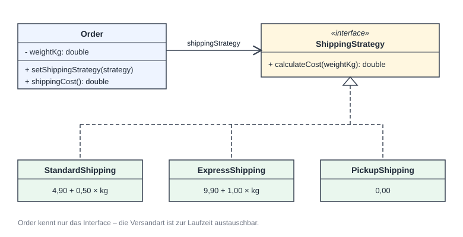
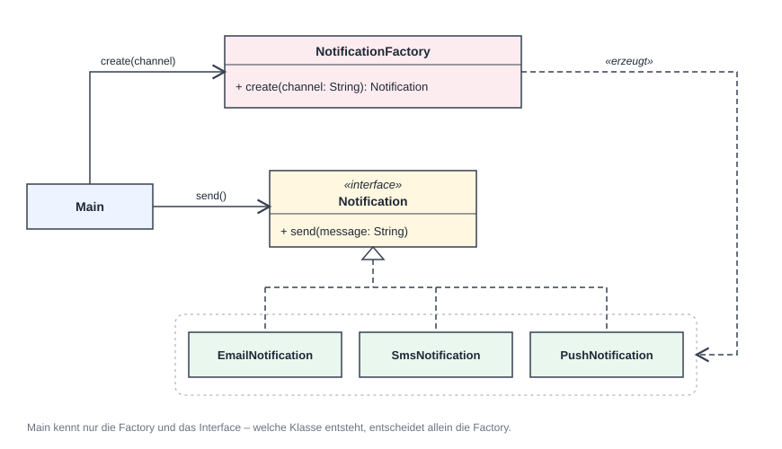

# ols-sp-007 – Design Patterns (Java · Python · JavaScript · Dart)

Jedes Pattern wird später in allen vier Sprachen als eigenes, einfaches Projekt umgesetzt –
ohne Build-Tools (kein Maven, kein npm, kein pip).

```
.
├── java/
│   └── 00-vorlage/
│       └── src/Main.java
├── python/
│   └── 00-vorlage/
│       └── main.py
├── javascript/
│   └── 00-vorlage/
│       └── main.js
└── dart/
    └── 00-vorlage/
        └── main.dart
```

## Konvention

- Ein Ordner pro Projekt, in allen vier Sprachen mit **gleichem Namen**, z. B. `01-singleton`.
- Einstiegspunkt: `src/Main.java` (Java), `main.py` (Python), `main.js` (JavaScript), `main.dart` (Dart).
- Neues Projekt = Ordner `00-vorlage` kopieren und umbenennen.

## Patterns

### 01 – Strategy (Versandkosten)



### 02 – Factory (Benachrichtigungen)



## Voraussetzungen

| Sprache    | Version | Prüfen mit                        |
|------------|---------|-----------------------------------|
| Java (JDK) | ≥ 21    | `java -version` und `javac -version` |
| Python     | ≥ 3.11  | `python --version`                |
| Node.js    | ≥ 20    | `node --version`                  |
| Dart SDK   | ≥ 3.0   | `dart --version`                  |

**JDK installieren:** z. B. [Eclipse Temurin](https://adoptium.net/) – im Installer
„Set JAVA_HOME“ und „Add to PATH“ aktivieren. Danach Terminal bzw. VS Code **neu starten**.

> Meldet das Terminal `java: Der Begriff „java“ wird nicht … erkannt`, ist das JDK nicht im PATH.
> Häufig liegt ein von VS Code/IntelliJ geladenes JDK unter `~/.jdks/…` – dann
> `JAVA_HOME` auf diesen Ordner setzen und `%JAVA_HOME%\bin` zum PATH hinzufügen.

**VS Code:** Beim Öffnen des Repos werden die empfohlenen Erweiterungen vorgeschlagen
(`.vscode/extensions.json`, u. a. *Extension Pack for Java*). Erscheint über `main` kein
„Run“, den jeweiligen Projektordner (z. B. `java/00-vorlage`) direkt öffnen.

## Ausführen

**Java** (JDK ≥ 21)
```bash
cd java/00-vorlage
javac -d out src/*.java
java -cp out Main
```

**Python** (≥ 3.11)
```bash
cd python/00-vorlage
python main.py
```

**JavaScript** (Node.js ≥ 20)
```bash
cd javascript/00-vorlage
node main.js
```

**Dart** (SDK ≥ 3.0)
```bash
cd dart/00-vorlage
dart run main.dart
```
